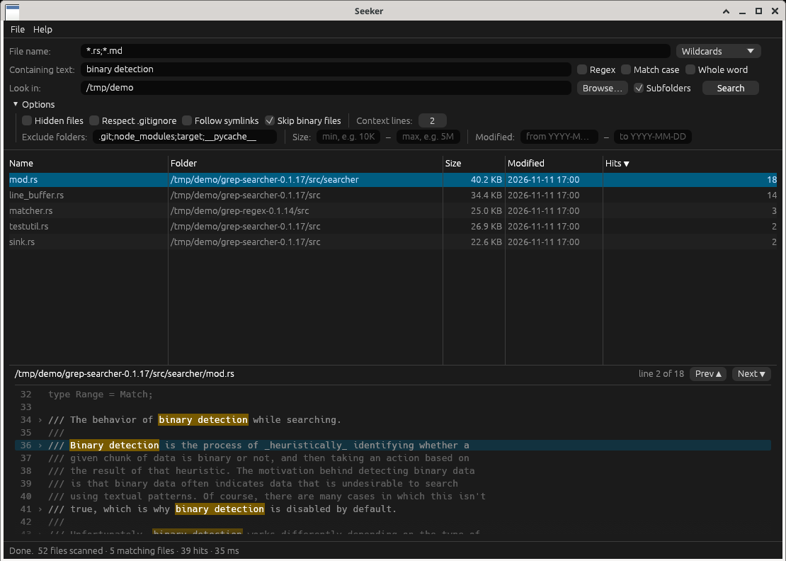

# Seeker

**Fast desktop file search for Linux.** Find files by name and by the text inside
them, with live streaming results, a highlighted preview of every matching line,
and the speed of [ripgrep](https://github.com/BurntSushi/ripgrep)'s search crates.
One native binary written in Rust with an [egui](https://github.com/emilk/egui) interface;
no Qt, GTK or Python needed.



> Seeker is an independent open-source project. It is not affiliated with,
> endorsed by, or derived from Mythicsoft or any of its products.

## Features

- **File name search** with wildcards (`*.rs;*.toml;!*.lock`, case-insensitive; a bare word
  like `report` means "name contains report") or a **regular expression**.
- **Containing text**: plain text or regex, match case, whole word.
- **Several start folders** at once (separate with `;`, `~` works), native folder picker,
  subfolders on/off.
- **Filters**: exclude folders (default `.git;node_modules;target;__pycache__`, wildcards allowed),
  respect `.gitignore`/`.ignore`, include hidden files, follow symlinks, skip binary files,
  size range (`10K`, `5M`, `1.5G`), modified-date range (`YYYY-MM-DD`).
- **Fast and responsive**: parallel directory walk on all CPU cores, results stream in while
  the search runs, **Stop** button / **Esc** to cancel, live counters in the status bar.
- **Results table**: name, folder, size, modified, hit count, click headers to sort.
- **Preview pane**: matching lines with line numbers, highlighted hits, configurable context
  lines, Prev/Next hit (F3 / Shift+F3).
- **Right-click**: open, open containing folder (selects the file in Files/Nautilus),
  open terminal here, copy path / name. Double-click opens the file.
- **Export** results to CSV or plain text.
- Remembers your last search settings.
- Copes with permission errors (listed, not fatal), non-UTF-8 and UTF-16 (BOM) files,
  huge files and very long lines. Skips `/proc`, `/sys`, `/dev` and `/run` when searching `/`.
- **Terminal mode**: `seeker --cli` prints `path:line:text`, handy for scripts.

### Keyboard

| Key | Action |
|-----|--------|
| Enter | Start search |
| Esc | Stop search |
| F3 / Shift+F3 | Next / previous hit in the preview |
| ↑ / ↓ | Move through results (when no text box has focus) |
| Ctrl+F | Focus the file-name box |

## Install with apt (Ubuntu, Zorin, Mint, Debian)

**Ubuntu 24.04 / Zorin OS 18 / Mint 22: PPA** (once published), which gives automatic updates:

```sh
sudo add-apt-repository ppa:electricstars/seeker
sudo apt update
sudo apt install seeker
```

**Any Ubuntu 20.04+ or Debian 11+: .deb from the releases page.** Download
`seeker_X.Y.Z_amd64.deb` from [Releases](https://github.com/ElectricStars/seeker/releases), then:

```sh
sudo apt install ./seeker_*_amd64.deb
```

Remove with `sudo apt remove seeker`. The Debian packaging lives in `debian/` (PPA builds) and
`[package.metadata.deb]` in `Cargo.toml` (the release `.deb`, built with `cargo deb`). See
`packaging/` for the helper scripts.

## Install (pre-built binary)

Download `seeker-vX.Y.Z-x86_64-linux.tar.gz` from the
[Releases](https://github.com/ElectricStars/seeker/releases) page, then:

```sh
tar xzf seeker-*-x86_64-linux.tar.gz
cd seeker-*-x86_64-linux
./install.sh          # installs to ~/.local/bin + adds a menu entry (no sudo)
seeker                # or launch "Seeker" from the applications menu
```

Uninstall with `./install.sh --uninstall`.

**`install.sh` is optional.** `seeker` is a single self-contained binary: you can run it
straight from any folder (`./seeker`), or copy it anywhere on your `PATH` yourself.
The script only adds the menu entry and icon for convenience.

The binary is built against glibc 2.31, so it runs on Ubuntu 20.04+, Debian 11+,
Zorin OS 16+, Linux Mint 20+, Fedora 32+ and similar. Runtime libraries are loaded
dynamically and are present on any normal desktop install: Mesa OpenGL/EGL
(`libgl1`, `libegl1`), `libxkbcommon0`, `libxkbcommon-x11-0`, X11 (`libx11-6`, `libxcursor1`,
`libxrandr2`, `libxi6`) and/or Wayland (`libwayland-client0`, `libwayland-egl1`).
It works on both X11 and Wayland sessions. The folder picker and save dialog use
the desktop portal (`xdg-desktop-portal`, standard on GNOME/KDE), falling back to `zenity`.

## Build from source

On Ubuntu / Zorin / Debian:

```sh
sudo apt install build-essential pkg-config git curl
curl --proto '=https' --tlsv1.2 -sSf https://sh.rustup.rs | sh   # Rust stable, if needed
source "$HOME/.cargo/env"

git clone https://github.com/ElectricStars/seeker.git
cd seeker
cargo build --release
./target/release/seeker
./install.sh            # optional: install binary + menu entry for your user
```

No GUI toolkit `-dev` packages are needed: windowing, OpenGL and Wayland libraries
are loaded at runtime. Minimum Rust version: 1.95 (required by egui 0.37).

Development:

```sh
cargo test                              # unit tests (search engine, CLI, export)
cargo clippy --all-targets -- -D warnings
cargo fmt
```

To build a portable binary with an old glibc baseline (what the release workflow does):

```sh
pip install ziglang && cargo install cargo-zigbuild
cargo zigbuild --release --target x86_64-unknown-linux-gnu.2.31
```

## Usage

```sh
seeker                                   # open the window
seeker ~/projects                        # open with a folder prefilled
seeker -n "*.rs" -t "TODO" --auto ~/src  # prefill and start searching immediately
seeker --cli -n "*.py" -t "import numpy" ~/code      # terminal output
seeker --cli -e -t "fn\s+main" -l .                  # regex, list files only
seeker --help
```

CLI exit status: 0 = something found, 1 = nothing found, 2 = error.

Settings are stored in `~/.local/share/seeker/app.ron`.

## How it works

`src/search.rs` is a GUI-free engine built on the crates that power ripgrep:
[`ignore`](https://crates.io/crates/ignore) for the parallel, gitignore-aware walk,
[`grep-regex`](https://crates.io/crates/grep-regex) + [`grep-searcher`](https://crates.io/crates/grep-searcher)
for fast line-oriented matching with binary detection and BOM transcoding, and
[`globset`](https://crates.io/crates/globset) for name patterns. Worker threads stream hits
over a channel to the egui front end (`src/ui.rs`), which never blocks.

## Renaming the app

"Seeker" is a working name, kept in as few places as possible:

1. `Cargo.toml` → `name = "seeker"` (binary name)
2. `src/main.rs` → `APP_NAME` (display name), `APP_ID` (settings folder) and `DESKTOP_ID`
3. `data/io.github.ElectricStars.Seeker.*` (desktop file, icon, AppStream metainfo) → `Name=` / `<name>`.
   Changing the application id itself (`io.github.ElectricStars.Seeker`) means renaming these files
   and is not recommended once the app is published in software stores.
4. `install.sh` → `APP=seeker`; `.github/workflows/*.yml` → `APP: seeker` and the CLI smoke test

A quick way to find every occurrence: `grep -rni seeker --exclude-dir=target --exclude-dir=.git .`

## Contributing

See [CONTRIBUTING.md](CONTRIBUTING.md). CI runs `fmt`, `clippy` and tests on every push and
rebuilds monthly with the latest stable Rust. Pushing a tag such as `v0.1.0` builds and
attaches the Linux release tarball automatically.

## Desktop integration and sandboxing

The application id is `io.github.ElectricStars.Seeker`; the desktop file, icon and AppStream
metainfo in `data/` use it. When Seeker runs inside a Flatpak sandbox it opens files and folders
through the desktop's OpenURI portal, and the folder picker and save dialog use the FileChooser
portal. A sandboxed app can't start programs on the host, so "Open terminal here" copies a
`cd <folder>` command to the clipboard instead.

## Credits

- **Eric Allen ([ElectricStars](https://github.com/ElectricStars))** — author and maintainer
- **Grokles** (AI assistant via Grok Bot) — co-developer; wrote the code
- **Inspiration:** [Agent Ransack](https://www.mythicsoft.com/agentransack/) by Mythicsoft.
  Seeker is an independent project, written from scratch, and is not affiliated with
  or endorsed by Mythicsoft.

## AI disclosure

Seeker was written with substantial help from an AI assistant. Grokles (an AI assistant running
on Grok Bot) wrote essentially all of the code in `src/`, the tests, `install.sh`, the CI and
release workflows, the desktop file, AppStream metainfo, the icon and the documentation, directed
and reviewed by Eric Allen, who maintains the project.

## License

Copyright (C) 2026 Eric Allen

This program is free software: you can redistribute it and/or modify it under the terms
of the GNU General Public License as published by the Free Software Foundation, either
version 3 of the License, or (at your option) any later version.

This program is distributed in the hope that it will be useful, but WITHOUT ANY WARRANTY;
without even the implied warranty of MERCHANTABILITY or FITNESS FOR A PARTICULAR PURPOSE.
See the [GNU General Public License](LICENSE) for more details.
Third-party crate licenses are listed in [THIRD-PARTY.md](THIRD-PARTY.md).

SPDX-License-Identifier: `GPL-3.0-or-later`
